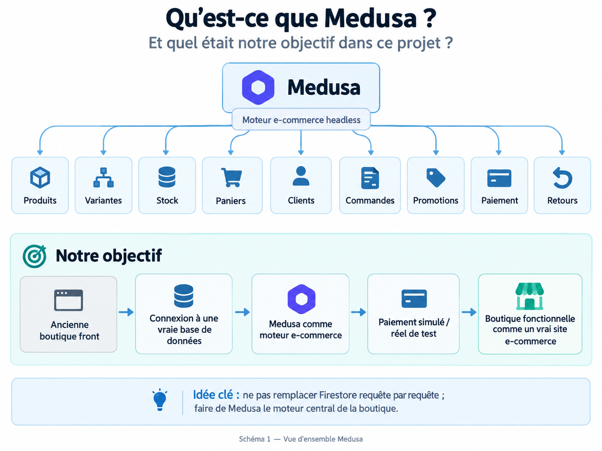
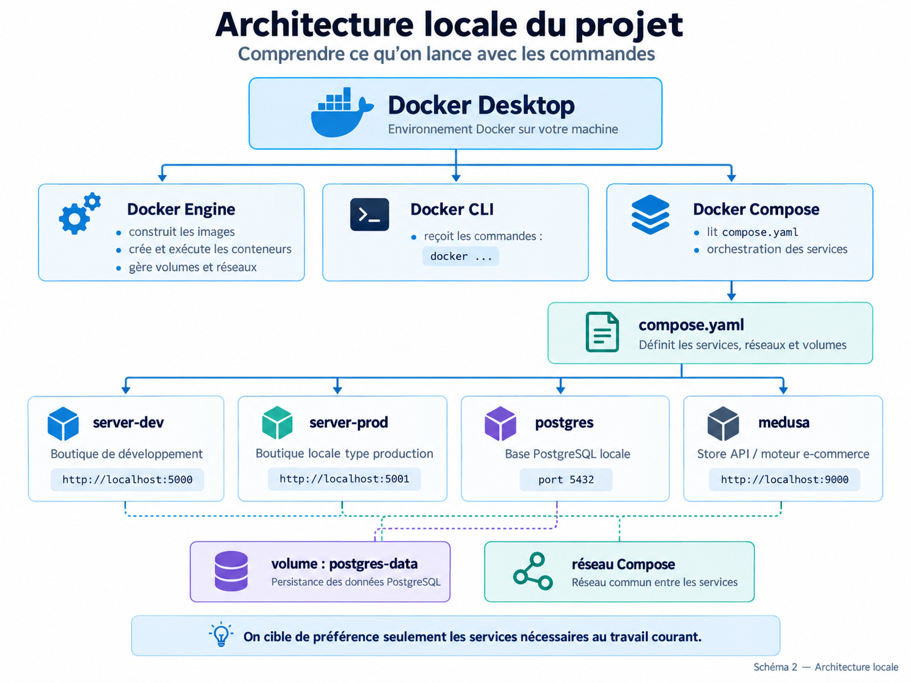
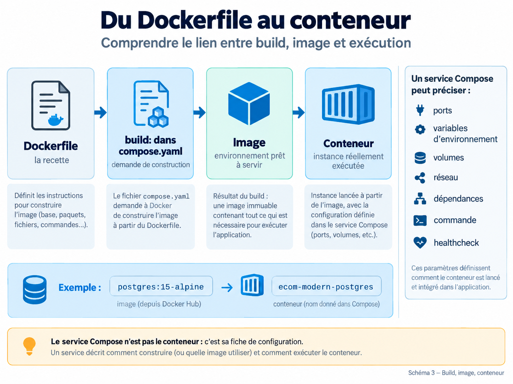
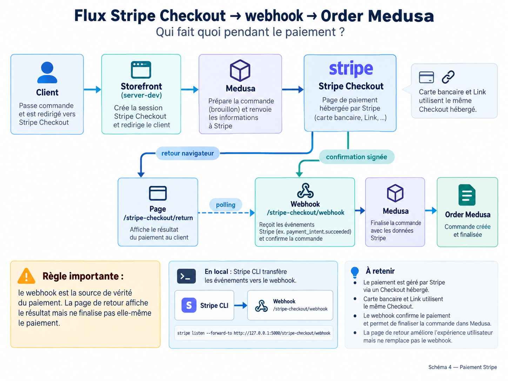

# INFRASTRUCTURE MEDUSA + STOREFRONT — v8

## Table des matières

- [Suivi des modifications](#suivi-des-modifications)
1. [Rôle des composants](#1-rôle-des-composants)
2. [Les stockages à ne pas confondre](#2-les-stockages-à-ne-pas-confondre)
3. [Emails : trois notions différentes](#3-emails--trois-notions-différentes)
   - [3.1 Boîte mail professionnelle](#31-boîte-mail-professionnelle)
   - [3.2 Email transactionnel](#32-email-transactionnel)
   - [3.3 Email marketing](#33-email-marketing)
4. [Stockage médias et bande passante](#4-stockage-médias-et-bande-passante)
   - [4.1 Cloudflare R2 — choix officiel pour les médias](#41-cloudflare-r2--choix-officiel-pour-les-médias)
     - [4.1.1 Flux réel des images : Medusa → R2 → storefront](#411-flux-réel-des-images--medusa--r2--storefront)
     - [4.1.2 Configuration locale F-19](#412-configuration-locale-f-19)
     - [4.1.3 Politique d’upload actuelle](#413-politique-dupload-actuelle)
     - [4.1.4 Cycle de vie des médias gérés](#414-cycle-de-vie-des-médias-gérés)
     - [4.1.5 Validation manuelle F-19](#415-validation-manuelle-f-19)
     - [4.1.6 Limites connues et suites](#416-limites-connues-et-suites)
     - [4.1.7 Caractéristiques et coûts R2](#417-caractéristiques-et-coûts-r2)
   - [4.2 Scaleway Object Storage — alternative France / Union européenne](#42-scaleway-object-storage--alternative-france--union-européenne)
   - [4.3 Render](#43-render)
5. [Configuration production retenue pour l’étude](#5-configuration-production-retenue-pour-létude)
6. [Pourquoi le mode shared est retenu au départ](#6-pourquoi-le-mode-shared-est-retenu-au-départ)
7. [Options retenues et alternatives à conserver](#7-options-retenues-et-alternatives-à-conserver)
8. [Risque d’évolution des services tiers](#8-risque-dévolution-des-services-tiers)
9. [Projet, hébergement et archivage](#9-projet-hébergement-et-archivage)
10. [Démonstrateur commercial vs boutique client](#10-démonstrateur-commercial-vs-boutique-client)
11. [Évolution possible](#11-évolution-possible)
12. [Principes commerciaux et avantages de l’architecture](#12-principes-commerciaux-et-avantages-de-larchitecture)
13. [Propriété et réutilisation du code](#13-propriété-et-réutilisation-du-code)
14. [Socle e-commerce MVDW configurable et évolution multi-vendeur](#14-socle-e-commerce-mvdw-configurable-et-évolution-multi-vendeur)
15. [Architecture locale Docker / Docker Compose](#15-architecture-locale-docker--docker-compose)
16. [Paiement Stripe, webhook et création d’Order Medusa](#16-paiement-stripe-webhook-et-création-dorder-medusa)
17. [Sources techniques principales](#17-sources-techniques-principales)

---

## Suivi des modifications

| Version | Date de publication | Modification | Chapitre / paragraphe concerné |
|---|---|---|---|
| v8 | 09/10/2026 | Mise à jour de la référence de tests Playwright à 35 scénarios déclarés et documentation du reset Checkout, de la remise à zéro de la livraison entre sessions Checkout et du remplacement exclusif Standard ↔ Express. | `16. Paiement Stripe, webhook et création d’Order Medusa` — `16.13 Tests associés` |

---

> Document technique de référence pour l’infrastructure e-commerce basée sur Medusa et son storefront.
> Le `README.md` principal reste centré sur l’utilisation quotidienne, le démarrage, l’arrêt, le développement, les tests et la maintenance courante.
>
> **Version documentaire : v8 — mise à jour du 09/10/2026.**
> **Dernière mise à jour des tarifs et choix de stockage médias : septembre 2026.**
> Les tarifs externes doivent être revérifiés avant tout devis client.
>
> **Schémas :** les images utilisées dans ce document sont stockées dans `./images/architecture/`.

---

## 1. Rôle des composants



| Élément | Son rôle concret |
| --- | --- |
| **Storefront** | Le site que voit le client : accueil, catalogue, fiches produits, panier et checkout. Dans notre cas, il s’agit du front de la boutique. |
| **Serveur Medusa** | Le cerveau e-commerce côté serveur. Il expose les API et exécute la logique liée aux produits, paniers, commandes, promotions, clients, stocks et retours. |
| **Worker Medusa** | Effectue les tâches de fond qui ne doivent pas ralentir le serveur principal : traitements asynchrones, événements, automatisations et tâches planifiées. |
| **PostgreSQL** | La **mémoire permanente** de la boutique : produits, commandes, clients, stocks, promotions et paniers. C’est la donnée commerciale essentielle. |
| **PITR PostgreSQL** | *Point-In-Time Recovery*. Permet de restaurer la base à un instant précis après une erreur ou une panne, par exemple « revenir à 14 h 37 ». |
| **Redis** | Mémoire très rapide et temporaire utilisée pour le cache, les événements, les verrous et d’autres opérations techniques. **Ce n’est pas notre base commerciale principale.** |
| **S3 / Object Storage** | Stocke les images produits et autres fichiers. Medusa y accède via son File Module et un provider compatible S3 ; Cloudflare R2 est le service de stockage de référence actuel. Notre référence commerciale est **50 Go de stockage médias**. |
| **Sauvegardes** | Permettent de restaurer PostgreSQL et les autres données importantes en cas d’erreur, panne ou suppression accidentelle. |
| **Monitoring** | Surveille la disponibilité, la vitesse, les erreurs, l’utilisation CPU/RAM et les logs afin de détecter rapidement un problème. |
| **Email transactionnel / marketing** | Service d’envoi automatisé : confirmations de commande, réinitialisations de mot de passe, notifications d’expédition, remboursements, paniers abandonnés et newsletters. |
| **Boîte mail professionnelle** | Messagerie utilisée humainement par l’entreprise : `contact@maboutique.fr` ou `sav@maboutique.fr`. Elle est distincte du service d’envoi automatisé. |
| **Domaine** | `maboutique.fr`, l’adresse publique du site. Un sous-domaine comme `api.maboutique.fr` peut également être utilisé. |
| **Stripe / prestataire de paiement** | Traite réellement l’argent : carte bancaire et remboursements. Medusa lui transmet les opérations de paiement. |
| **CDN** | Distribue les fichiers depuis des serveurs proches des visiteurs afin d’accélérer le chargement et d’absorber plus facilement le trafic. |
| **Admin Medusa** | Interface de gestion utilisée par le commerçant pour administrer les produits, commandes, clients, stocks, promotions et retours. |
| **Gestion du consentement** | Affiche et applique le choix du visiteur concernant les cookies et services nécessitant un consentement. Option retenue : **Klaro**, sans licence supplémentaire. |

---

## 2. Les stockages à ne pas confondre

- **Stockage médias** : images produits, documents et autres fichiers. Référence retenue : **50 Go**.
- **Stockage PostgreSQL** : données structurées de la boutique : produits, commandes, clients, stocks et promotions.
  Le registre technique `managed_media` utilisé par F-19 y conserve aussi les `fileId` nécessaires au cycle de vie contrôlé des médias.
- **Stockage de la boîte mail professionnelle** : messages et pièces jointes de `contact@...` ou `sav@...`.
- **Stockage des sauvegardes** : copies ou journaux permettant de restaurer les données.
- **Stockage réservé** : espace disque conservé pour un service, même lorsqu’il ne consomme plus de puissance de calcul. Ce stockage peut donc rester facturé alors qu’un service est suspendu.
- **Redis** : mémoire temporaire rapide ; ce n’est pas un stockage commercial permanent.

---

## 3. Emails : trois notions différentes

### 3.1 Boîte mail professionnelle

Exemple : `contact@maboutique.fr`.

Elle sert aux échanges humains avec les clients et fournisseurs.

**Option de référence actuelle : OVHcloud Zimbra Pro**
- 1 boîte ;
- 50 Go ;
- 1,82 € HT/mois, soit 2,19 € TTC/mois au tarif affiché en septembre 2026 ;
- sauvegarde quotidienne ;
- antispam ;
- antivirus.

### 3.2 Email transactionnel

Envois automatiques générés par le site :
- confirmation de commande ;
- réinitialisation de mot de passe ;
- notification d’expédition ;
- confirmation de remboursement ;
- panier abandonné ;
- notifications de compte et de commande.

### 3.3 Email marketing

Newsletters et campagnes marketing.

**Option de référence actuelle : Brevo Standard**
- jusqu’à 500 contacts au premier palier ;
- 5 000 emails/mois ;
- 17 €/mois au tarif affiché en septembre 2026 ;
- automatisation marketing ;
- rapports avancés.

**Important : Brevo n’est pas notre boîte mail professionnelle.**
Brevo est utilisé comme plateforme d’envoi automatisé et marketing. La boîte `contact@...` reste hébergée chez un fournisseur de messagerie tel qu’OVHcloud.

---

## 4. Stockage médias et bande passante

La bande passante sortante correspond aux données envoyées depuis nos services vers les visiteurs.

### 4.1 Cloudflare R2 — choix officiel pour les médias

Cloudflare R2 est le stockage objet retenu pour les images et médias du projet.

Cloudflare R2 est le **service de stockage**. Medusa ne communique pas directement avec R2 comme avec une dépendance métier : le **File Module Medusa** délègue le stockage à un **provider S3 compatible**, actuellement `@medusajs/medusa/file-s3`. R2 reste donc un provider remplaçable.

### 4.1.1 Flux réel des images : Medusa → R2 → storefront

```text
Medusa Admin
     │
     ▼
File Module Medusa
     │
     ▼
Provider S3
     │
     │ utilise R2_ENDPOINT
     ▼
Cloudflare R2
     │
     ▼
Bucket
mvdw-ecommerce-media-dev
     │
     └── uploads/
          └── image.webp
               │
               │ URL publique
               ▼
          R2_FILE_URL
               │
               ▼
          Storefront
```

Le même flux peut être résumé ainsi :

```text
Medusa ───────► R2_ENDPOINT ───────► Bucket
                                      │
                                      ▼
                                  image.webp
                                      │
                                      ▼
Storefront ◄──── R2_FILE_URL ◄────────┘
```

À retenir :

- **Cloudflare R2** = service de stockage objet ;
- **provider S3** = connecteur utilisé par Medusa pour parler à R2 via l’API compatible S3 ;
- **bucket** = conteneur de stockage dans R2 ;
- **`R2_ENDPOINT`** = adresse technique utilisée par Medusa pour envoyer, lire ou supprimer les fichiers via l’API S3 ;
- **`R2_FILE_URL`** = adresse publique utilisée par le navigateur pour afficher les images ;
- **R2 n’est donc pas le provider S3** : R2 est le stockage, le provider S3 est l’adaptateur logiciel entre Medusa et ce stockage.

### 4.1.2 Configuration locale F-19

Pour le développement actuel, le bucket utilisé est :

```text
mvdw-ecommerce-media-dev
```

Le **Public Development URL** `r2.dev` est utilisé pour les essais locaux. En production, un domaine personnalisé dédié aux médias est préférable.

Les variables suivantes sont attendues dans :

```text
medusa/apps/backend/.env
```

Ce fichier est local et non versionné. Les valeurs sensibles ne doivent jamais être copiées dans la documentation ni committées :

```env
R2_FILE_URL=
R2_ACCESS_KEY_ID=
R2_SECRET_ACCESS_KEY=
R2_BUCKET=
R2_ENDPOINT=
```

Correspondance :

```text
R2_ENDPOINT
→ S3 API de Cloudflare R2
→ porte d'entrée technique utilisée par Medusa

R2_FILE_URL
→ URL publique de diffusion
→ utilisée par le storefront pour afficher les images
```

Le `.env` racine du projet ne doit pas contenir une seconde copie de ces variables R2 si le service Medusa les charge depuis `medusa/apps/backend/.env`, afin d’éviter plusieurs sources de configuration concurrentes.

### 4.1.3 Politique d’upload actuelle

Le flux F-19 utilise l’endpoint Admin natif de Medusa et le File Module. Aucun endpoint public personnalisé d’upload R2 n’est nécessaire.

Politique V1 actuelle :

- formats autorisés : JPEG/JPG, PNG et WebP ;
- taille maximale : 1 Mio par fichier ;
- maximum : 10 fichiers par opération ;
- aucun upload direct du navigateur vers R2 ;
- les médias AWS S3 legacy ne sont pas supprimés automatiquement pendant la migration ;
- le remplacement physique d’un fichier doit intervenir seulement après la sauvegarde réussie du Product qui référence le nouveau média.

### 4.1.4 Cycle de vie des médias gérés

Medusa 2.19 retourne, lors d’un upload Admin, un objet contenant notamment un identifiant de fichier et son URL publique. Le Product Medusa conserve ensuite principalement l’URL du média : l’identifiant du File Module n’est pas conservé directement dans `Product.images`.

Pour éviter de devoir reconstruire une clé de fichier en découpant une URL, F-19 ajoute un registre Medusa minimal nommé `managed_media`, stocké dans PostgreSQL.

```text
Upload Admin
   │
   ▼
POST /admin/uploads
   │
   ▼
File Module
   │
   ├── fileId exact
   └── URL publique
          │
          ▼
managed_media
status = pending
          │
          ▼
Save Product réussi
          │
          ▼
association exacte par URL
          │
          ▼
status = associated
```

Le registre `managed_media` conserve notamment :

```text
file_id
url
status
product_id
product_image_id
deletion_attempts
last_error
```

Le principe est volontairement indépendant de Cloudflare R2 : le Core connaît le File Module et le `fileId`, tandis que R2 reste un provider remplaçable.

#### Dissociation et suppression contrôlée

Lorsqu’un média géré est retiré d’un Product :

```text
ancien média associé
       │
       ▼
modification du Product dans l’Admin
       │
       ▼
Save Product
       │
       ├── échec
       │     └── ancien fichier conservé
       │
       └── succès
             │
             ▼
      vérification des références
             │
             ├── encore référencé
             │     └── retained_referenced
             │
             └── plus référencé
                   │
                   ▼
             deletion_pending
                   │
                   ▼
          deleteFilesWorkflow(fileId)
                   │
                   ▼
             deletion_requested
```

La suppression physique n’est donc demandée qu’après la réussite de la sauvegarde du Product. Le `fileId` enregistré est utilisé directement ; aucune suppression ne dépend d’un parsing de l’URL publique.

Les médias AWS S3 legacy restent hors de ce mécanisme et ne doivent pas être supprimés automatiquement par F-19.

#### Cas d’un upload non associé

Si un upload réussit mais que la sauvegarde du Product échoue, le nouveau média reste en `pending`. Il est donc identifiable comme fichier potentiellement orphelin et récupérable.

Aucun nettoyage automatique temporel des `pending` n’est actuellement activé.

### 4.1.5 Validation manuelle F-19

Le flux F-19 a été validé manuellement de bout en bout en septembre 2026.

#### Upload et affichage

```text
Medusa Admin
→ ajout d’une image
→ Save
→ objet créé dans R2 /uploads
→ Product Medusa mis à jour
→ image visible dans le storefront
→ managed_media = associated
```

Résultat : **validé**.

#### Règles d’upload

| Test | Résultat |
| --- | --- |
| JPEG / PNG / WebP ≤ 1 Mio | accepté |
| GIF | refusé |
| fichier > 1 Mio | refusé |
| plus de 10 fichiers en une opération | refusé |
| fichier refusé écrit dans R2 | non |

L’interface Admin peut encore afficher, dans certains cas de refus, un message technique du type `Field 'images, x, url' is required` au lieu d’un message utilisateur explicite.

#### Dissociation

```text
image gérée associée au Product
→ retrait dans Medusa Admin
→ Save
→ image absente du storefront
→ suppression demandée via le File Module
→ objet physiquement absent de R2
→ managed_media = deletion_requested
→ deletion_attempts = 1
→ last_error vide
```

Résultat : **validé**.

#### Remplacement d’une image

Un scénario complet A → B a également été testé :

```text
Image A
→ upload
→ R2
→ storefront
→ associated

puis

retrait de A
+ ajout de B
→ Save
→ A supprimée de R2
→ B présente dans R2
→ B visible dans le storefront
→ A = deletion_requested
→ B = associated
```

Résultat : **validé**.

Cette validation confirme le flux réel suivant :

```text
Medusa Admin
     │
     ▼
File Module
     │
     ▼
provider S3
     │
     ▼
Cloudflare R2
     │
     ▼
Product Medusa
     │
     ▼
Store API
     │
     ▼
Storefront
```

ainsi que le cycle inverse de suppression contrôlée après sauvegarde réussie du Product.

### 4.1.6 Limites connues et suites

Les limites suivantes restent connues après validation F-19 :

- les objets R2 créés avant l’introduction de `managed_media` ne sont pas automatiquement adoptés par le registre ;
- les médias AWS S3 legacy restent hors de ce mécanisme ;
- les lignes `pending` potentiellement orphelines sont conservées sans expiration automatique ;
- un média `retained_referenced` nécessite actuellement une réévaluation ultérieure si sa dernière autre référence disparaît ;
- la suppression d’un Product entier n’est pas encore couverte par ce cycle de nettoyage ;
- le statut `deletion_requested` indique que la suppression a été demandée ; lors des tests manuels, la disparition physique de l’objet a été confirmée directement dans R2 ;
- l’UX des messages de refus d’upload dans Medusa Admin peut encore être améliorée.

Le mécanisme F-19 couvre donc désormais le cycle principal :

```text
upload
→ association
→ affichage
→ dissociation
→ remplacement
→ suppression physique contrôlée
```

sans suppression destructive des médias legacy.


### 4.1.7 Caractéristiques et coûts R2

- compatible avec l’API Amazon S3 ;
- compatible avec le File Module Medusa via le provider S3 ;
- stockage R2 Standard : **0,015 $/Go/mois** ;
- **10 Go de stockage gratuits chaque mois** ;
- 1 million d’opérations de classe A gratuites chaque mois ;
- 10 millions d’opérations de classe B gratuites chaque mois ;
- **sortie Internet des données gratuite** ;
- domaine personnalisé possible, par exemple `images.maboutique.fr` ;
- cache Cloudflare utilisable devant le bucket ;
- juridiction `eu` disponible pour imposer le stockage et le traitement des objets dans l’Union européenne.

Pour notre référence de **50 Go de médias**, 10 Go sont compris dans l’offre gratuite et 40 Go sont facturés :

- 40 Go × 0,015 $ = **0,60 $/mois** ;
- soit **7,20 $/an**, hors éventuel dépassement des quotas gratuits d’opérations.

Le coût de diffusion des images vers les visiteurs ne dépend pas du volume de sortie Internet R2, car cette sortie est actuellement gratuite.

Exemple : une image de 1 Mo chargée 1 000 fois représente environ 1 Go de trafic sortant, mais R2 ne facture pas cette sortie Internet.

### 4.2 Scaleway Object Storage — alternative France / Union européenne

Scaleway reste une alternative importante lorsque la localisation précise en France est une priorité.

- compatible avec l’API Amazon S3 ;
- compatible avec le File Module Medusa via le provider S3 ;
- Standard Multi-AZ : environ **0,01606 € HT/Go/mois** ;
- requêtes incluses ;
- trafic entrant inclus ;
- **75 Go de trafic sortant inclus par mois** ;
- puis environ **0,01 € HT/Go** ;
- région `fr-par` permettant de choisir explicitement Paris, France ;
- Edge Services disponible séparément si un CDN dédié est souhaité.

Scaleway n’est pas le choix par défaut du projet, mais reste notre variante privilégiée lorsqu’un client veut une localisation précisément française des médias.

### 4.3 Render

Le workspace Hobby comprend actuellement :
- **5 Go/mois de bande passante sortante** ;
- puis 0,15 $/Go.

Les images étant récupérées directement par le navigateur depuis Cloudflare R2 et son cache, elles ne doivent normalement pas transiter par Render. Render transporte surtout les réponses API et les autres données du backend.

Architecture recherchée :

```text
                    ┌── Render
                    │   Medusa / API
Client ─────────────┤
                    │
                    └── Cloudflare R2 / cache
                        images et médias
```

---

## 5. Configuration production retenue pour l’étude

### 5.1 Niveau 1 — Infrastructure Medusa « lancement sérieux » en mode shared

Le serveur Medusa et les tâches worker fonctionnent initialement dans la même instance.

| Poste | Choix de référence |
| --- | --- |
| Medusa Server + Worker shared | Render 1 CPU / 2 Go RAM |
| PostgreSQL | Render managé 1 Go RAM |
| Stockage PostgreSQL | 10 Go |
| Redis / Key Value | Render 256 Mo |
| Storefront statique | Render Static Site |
| PITR PostgreSQL | Inclus dans l’offre PostgreSQL payante Render |
| Monitoring / logs | Render |
| TLS / CDN storefront | Render |
| Stockage médias | Cloudflare R2 Standard — 50 Go de référence |
| Email transactionnel / marketing | Brevo Standard |
| Boîte mail professionnelle | OVHcloud Zimbra Pro — 50 Go |
| Domaine | OVHcloud `.fr` |
| Consentement cookies | Klaro |

**Ordre de grandeur normalisé actuel : environ 833 €/an HT**, hors dépassements de consommation, dépassements éventuels des quotas d’opérations R2 et commissions de paiement.

C’est **la configuration de référence pour l’article**.

### 5.2 Niveau 2 — Infrastructure renforcée avec Worker séparé

Même architecture, mais ajout d’un Worker Medusa indépendant sur Render.

**Ordre de grandeur actuel : environ 1 095–1 100 €/an.**

Ce niveau est à envisager lorsque le trafic ou les traitements de fond le justifient. Il ne sera pas utilisé comme scénario principal dans l’article.

### 5.3 Référence WordPress.com Commerce

Pour mémoire dans le comparatif :

- **socle structurel récurrent WordPress.com normalisé : environ 581 €/an HT** ;
- **ce montant inclut déjà le RMA retenu à 79 $US/an** ;
- **écart structurel avec Medusa shared : environ 252 €/an HT, soit environ 21 €/mois HT**.

Le détail exact du comparatif WordPress doit rester dans le document éditorial dédié à l’article, pas dans le README du projet.

---

## 6. Pourquoi le mode shared est retenu au départ

Le mode shared permet de faire fonctionner le serveur Medusa et les tâches worker sur la même instance.

Ce choix est retenu pour une boutique client de taille raisonnable afin de :
- limiter le coût fixe initial ;
- conserver une architecture professionnelle ;
- éviter de payer immédiatement un Worker séparé qui n’est pas encore nécessaire ;
- garder la possibilité de séparer le Worker plus tard si le trafic ou les traitements de fond l’exigent.

Le passage à un Worker séparé est une évolution de capacité, pas une reconstruction du projet.

---

## 7. Options retenues et alternatives à conserver

| Besoin | Option de référence | Alternatives possibles |
| --- | --- | --- |
| PaaS backend | **Render** | Scalingo, Scaleway/Clever Cloud, Medusa Cloud |
| PostgreSQL | **Render managé** | Scalingo, Scaleway, OVHcloud |
| Redis | **Render Key Value** | Scalingo Redis, Redis managé chez un autre fournisseur |
| Storefront | **Render Static Site** | Scaleway, Cloudflare Pages, Netlify, Vercel |
| Médias | **Cloudflare R2** | Scaleway Object Storage `fr-par`, OVHcloud Object Storage, Render Object Storage lorsqu’il sera suffisamment mature |
| Email automatisé / marketing | **Brevo Standard** | Resend, SendGrid, Mailchimp |
| Boîte mail professionnelle | **OVHcloud Zimbra Pro** | Titan, Google Workspace, Microsoft 365 |
| Domaine | **OVHcloud `.fr`** | Gandi, Infomaniak, Scaleway Domains |
| Paiement | **Stripe** | autre Payment Provider compatible ou intégrable |
| Livraison | **Connecteur Chronopost intégré à notre infrastructure** | Mondial Relay, Colissimo, autre transporteur intégré |
| Consentement cookies | **Klaro** | autre CMP open source ou commerciale adaptée au projet |
| Monitoring | **Render** | Grafana Cloud, Better Stack, UptimeRobot, solution managée équivalente |
| CDN | **Render pour le storefront + Cloudflare Cache pour les médias R2** | Scaleway Edge Services, autre CDN compatible |

**Principe architectural :** si un fournisseur augmente fortement ses tarifs, réduit ses quotas, supprime une fonction, diminue son niveau de service, change de modèle économique ou ne répond plus aux besoins du client, l’architecture doit permettre d’étudier le remplacement de cette brique sans reconstruire l’ensemble du projet.

### Pourquoi Cloudflare R2 est retenu pour les médias

Cloudflare R2 est retenu comme choix officiel parce qu’il réunit :
- compatibilité S3 avec le File Module Medusa ;
- faible coût de stockage ;
- 10 Go de stockage mensuel gratuit ;
- quotas gratuits d’opérations adaptés au démarrage ;
- sortie Internet gratuite pour les images ;
- intégration naturelle au cache Cloudflare ;
- domaine personnalisé pour les médias ;
- possibilité de choisir la juridiction `eu`.

Le principal avantage de R2 pour un e-commerce est que les images sont écrites peu souvent mais lues de nombreuses fois. La gratuité de la sortie Internet réduit donc une variable de coût qui pourrait augmenter avec le trafic.

**Scaleway reste l’alternative privilégiée pour une variante “médias hébergés précisément en France” grâce à la région `fr-par`.**

Le choix du stockage reste remplaçable : Medusa communique avec un provider compatible S3, ce qui limite le verrouillage technologique et permet d’étudier un changement de fournisseur sans reconstruire le projet.

---

## 8. Risque d’évolution des services tiers

Un service ou un plugin gratuit aujourd’hui n’est pas garanti gratuit ou identique pour toujours.

Un fournisseur peut :
- augmenter son tarif ;
- réduire un quota ;
- réserver une fonction auparavant gratuite à une offre payante ;
- supprimer une fonction ;
- modifier ses conditions d’utilisation ;
- changer de propriétaire ;
- réduire son niveau de support ;
- arrêter le produit ;
- arrêter la maintenance.

Cette règle s’applique aussi bien aux plugins WordPress qu’aux services utilisés dans notre infrastructure.

**Règle de comparaison :** les coûts du tableau correspondent aux tarifs et fonctions constatés en septembre 2026. Aucun coût futur hypothétique n’est ajouté au total.

**Règle d’architecture :** lorsqu’une fonction est intégrée à notre propre infrastructure et ne dépend pas d’une licence commerciale tierce, nous réduisons le risque qu’une décision commerciale externe modifie brutalement son coût.

---

## 9. Projet, hébergement et archivage

L’hébergement fait fonctionner le projet ; il ne doit pas être confondu avec le projet lui-même.

Une archive complète doit pouvoir contenir :
- le code source ;
- les fichiers de configuration nécessaires, sans exposer les secrets ;
- un dump PostgreSQL ;
- les médias ;
- la documentation de restauration ;
- la liste des services externes utilisés ;
- les versions importantes du projet.

Pour un arrêt temporaire ou long de l’activité :
1. créer une archive complète ;
2. vérifier qu’elle est exploitable ;
3. conserver les sauvegardes dans un emplacement indépendant ;
4. suspendre ou supprimer les ressources d’hébergement devenues inutiles ;
5. conserver uniquement le stockage nécessaire à l’archive.

Cette procédure permet de conserver le projet sans maintenir toute l’infrastructure active.

---

## 10. Démonstrateur commercial vs boutique client

### 10.1 Démonstrateur commercial

Le démonstrateur utilisé pour présenter l’offre à des prospects peut être hébergé avec une configuration beaucoup moins coûteuse et éventuellement suspendu lorsqu’il n’est pas utilisé.

Ce coût est une dépense commerciale de MVDW et **ne doit pas entrer dans le comparatif de l’article**.

### 10.2 Boutique client en production

Le comparatif de l’article doit utiliser la configuration de production « lancement sérieux » en mode shared, avec services managés.

---

## 11. Évolution possible

Lorsque la boutique grossit :

1. séparer le Worker ;
2. augmenter les ressources Medusa ;
3. augmenter les ressources PostgreSQL ;
4. augmenter Redis si nécessaire ;
5. augmenter la capacité médias ;
6. augmenter le quota d’emails ;
7. augmenter la bande passante ;
8. ajouter de la haute disponibilité si le niveau d’activité le justifie.

L’objectif est de faire évoluer uniquement les briques nécessaires **sans reconstruire le projet entier**.

---

## 12. Principes commerciaux et avantages de l’architecture

Cette section sert de référence pour l’argumentaire commercial et l’article. Elle ne doit pas être présentée comme une liste de promesses absolues : chaque avantage dépend de l’architecture réellement livrée et du contrat.

1. **Personnalisation beaucoup plus poussée** : un template peut aussi servir de point de départ et non de limite imposée au projet.
2. **Gain de temps pour l’entrepreneur** : il n’a pas à apprendre, sélectionner, assembler et dépanner lui-même tous les outils nécessaires.
3. **Réduction du stress et de la charge mentale liés à la technique.**
4. **Une explication simple du système est fournie**, avec une documentation permettant de comprendre les éléments essentiels sans devenir technicien.
5. **Accompagnement humain direct**, avec accompagnement en présentiel lorsque cela est possible.
6. **Transparence des coûts dès le départ** : prix de création, infrastructure, services externes et coûts récurrents sont identifiés avant le lancement.
7. **On paie uniquement pour ce dont on a besoin**, en évitant d’ajouter des licences récurrentes lorsqu’une fonction utile est déjà intégrée à l’infrastructure.
8. **Pas de licence supplémentaire par fonctionnalité déjà intégrée** à l’infrastructure proposée.
9. **Meilleure maîtrise et prévisibilité des coûts dans le temps**, notamment grâce au choix de briques dont les règles de facturation sont identifiables à l’avance ; pour les médias, R2 évite actuellement la facturation de la bande passante sortante.
10. **Résilience face aux changements des fournisseurs pour cause de hausse tarifaire, réduction de quota, passage d’une fonction au payant, suppression de fonction, changement de propriétaire, baisse du support ou diminution du niveau de service.**
11. **Possibilité de remettre les fournisseurs en concurrence** lorsqu’une offre devient moins intéressante.
12. **Choix des prestataires** : hébergement, base de données, stockage médias, email automatisé, boîte mail professionnelle, paiement, livraison, domaine, CDN et monitoring.
13. **Choix de la localisation des données**, notamment en France ou dans l’Union européenne lorsque les services retenus le permettent.
14. **Possibilité de changer d’hébergeur sans refaire tout le projet.**
15. **Évolutivité de l’infrastructure** : augmenter ou remplacer seulement la partie qui en a besoin.
16. **Possibilité de développer une fonctionnalité réellement spécifique** lorsque l’activité du client l’exige.
17. **Moins de dépendance aux décisions commerciales et techniques d’un seul fournisseur.**
18. **Le client garde la main sur son projet et son évolution.**
19. **Portabilité et archivage du projet** : le code, les données et les médias peuvent être conservés indépendamment de l’hébergement actif.

---

## 13. Propriété et réutilisation du code

La séparation suivante doit être prévue clairement dans les contrats :

| Élément | Principe |
| --- | --- |
| **Socle e-commerce générique MVDW** | Reste réutilisable par MVDW |
| **Modules génériques réutilisables** | Restent réutilisables par MVDW |
| **Scripts et outils génériques de déploiement** | Restent réutilisables par MVDW |
| **Développements spécifiques au client** | Droits définis précisément dans le contrat |
| **Contenus, photos, catalogue et données commerciales du client** | Appartiennent au client ou à leurs ayants droit |
| **Domaine** | Doit être contrôlé par le client ou transférable au client |
| **Composants open source** | Restent soumis à leurs licences respectives |

L’objectif est de protéger le socle réutilisable de MVDW tout en permettant au client de disposer réellement de son projet, de ses contenus et de ses données selon les droits définis au contrat.
---

## 14. Socle e-commerce MVDW configurable et évolution multi-vendeur

Cette section formalise deux contraintes d’architecture qui doivent guider la suite de la migration sans obliger à tout construire immédiatement.

### 14.1 Principe général

Le futur socle MVDW doit pouvoir être pensé en quatre familles :

```text
SOCLE E-COMMERCE MVDW
│
├── Core obligatoire
├── Modules optionnels
├── Providers remplaçables
└── Extensions futures
```

Le but est d’éviter qu’une fonction optionnelle devienne une dépendance obligatoire de toute la boutique.

### 14.2 Core obligatoire

Le Core correspond aux fonctions indispensables à une boutique standard :

- catalogue ;
- variantes ;
- prix ;
- stock ;
- clients ;
- Cart ;
- checkout ;
- paiement ;
- Order.

Ces fonctions doivent rester cohérentes même lorsqu’aucun module optionnel n’est activé.

### 14.3 Modules optionnels

Exemples de capacités pouvant devenir des modules/options selon le projet client :

- wishlist ;
- recherche avancée ;
- produits similaires / recommandations ;
- retours / RMA storefront ;
- panier abandonné ;
- newsletter ;
- marketing avancé ;
- multi-vendeur.

Le fait qu’une fonction soit décrite comme « module » ne signifie pas qu’elle doit immédiatement être extraite en package indépendant. L’objectif actuel est surtout de préserver des frontières propres et d’éviter les dépendances irréversibles.

### 14.4 Providers remplaçables

Certaines fonctions reposent sur des prestataires ou providers que l’architecture doit pouvoir remplacer :

- paiement : Stripe aujourd’hui ;
- médias : Cloudflare R2 aujourd’hui ;
- email : Brevo ou autre provider retenu ;
- transport : Chronopost ou autre intégration ;
- hébergement / base de données / cache selon l’infrastructure retenue.

Cette séparation participe à la portabilité commerciale et technique du socle.

### 14.5 Évolution multi-vendeur

La **première version opérationnelle reste mono-marchand**, mais le socle ne doit pas être conçu comme si cette contrainte était définitive.

L’objectif futur est de pouvoir proposer une option limitée à **2 ou 3 vendeurs identifiés et contrôlés**, avant toute éventuelle logique de marketplace ouverte.

À anticiper dans les décisions de conception :

- possibilité de représenter un `Vendor` sans réutiliser l’ancien rôle `seller` artisanal ;
- capacité future à relier produits, stocks et lignes de commande à un vendeur ;
- permissions d’administration limitées par vendeur si cette option est développée ;
- possibilité de faire évoluer la livraison et l’attribution des commandes par vendeur ;
- possibilité future d’un mécanisme de reversement ou de paiement multi-parties.

À **ne pas construire maintenant sans besoin explicite** :

- onboarding public de vendeurs ;
- portail vendeur complet ;
- commissions automatiques ;
- paiements multi-parties ;
- infrastructure de marketplace ouverte.

Le principe à retenir est donc :

```text
ancienne implémentation seller
→ destinée à disparaître

capacité Vendor future
→ à préserver dans l’architecture
```

### 14.6 Conséquence pour F-07 à F-13

Pour la migration actuelle :

- l’ancien système public « devenir vendeur » n’est pas conservé tel quel ;
- Medusa Admin reste l’outil d’administration de référence du mode mono-marchand ;
- la création, modification, suppression, publication et classification des produits doivent passer par les capacités Medusa ;
- les choix de modèle produit et de taxonomie ne doivent pas rendre impossible l’ajout futur d’un lien vers un vendeur.

---

## 15. Architecture locale Docker / Docker Compose

Cette section conserve les explications détaillées qui ne doivent pas encombrer le README mais restent utiles pour comprendre le fonctionnement du projet.



### 15.1 Docker Desktop, Docker Engine, Docker CLI et Docker Compose

```text
Docker Desktop
│
├── Docker Engine
│   ├── construit les images
│   ├── crée et exécute les conteneurs
│   ├── gère les volumes
│   └── gère les réseaux
│
├── Docker CLI
│   └── reçoit les commandes docker ...
│
└── Docker Compose
    ├── lit compose.yaml
    └── orchestre les services
```

`compose.yaml` est un fichier de configuration ; ce n’est pas Docker Compose.

### 15.2 Service Compose, image, Dockerfile et conteneur

Un service Compose est une fiche qui décrit comment un élément doit être préparé et exécuté.

Une image est l’environnement préparé.

Un conteneur est une instance réellement exécutée à partir d’une image.



Le `Dockerfile` est la recette utilisée par Docker Engine pour construire une image lorsqu’un service possède `build:`.

### 15.3 `build:` et `--build`

Dans `compose.yaml` :

```yaml
build:
  context: .
```

décrit **comment** l’image peut être construite.

Dans le terminal :

```powershell
docker compose up -d --build medusa
```

demande de reconstruire l’image **maintenant** avant le démarrage.

### 15.4 Image PostgreSQL et `postgres:15-alpine`

PostgreSQL utilise une image déjà préparée :

```yaml
postgres:
  image: postgres:15-alpine
```

```text
postgres:15-alpine
    │      │
    │      └── variante basée sur Alpine Linux
    │
    └── PostgreSQL version 15
```

Alpine Linux est une distribution Linux légère utilisée comme base de nombreuses images.

Lorsque Docker Engine affiche :

```text
Image postgres:15-alpine Pulled
```

`Pulled` signifie que l’image a été téléchargée depuis le registre configuré.

### 15.5 Ce que fait `docker compose up -d postgres`

Lors d’une première exécution, Docker Compose peut demander à Docker Engine de :

```text
docker compose up -d postgres
              │
              ├── récupérer postgres:15-alpine si nécessaire
              ├── créer le volume postgres-data
              ├── créer le conteneur PostgreSQL
              └── démarrer PostgreSQL
```

Le statut :

```text
healthy
```

signifie que le healthcheck défini pour le service a réussi.

### 15.6 Projet Compose, service, image et conteneur

Il faut distinguer :

```text
projet Compose : ecom-modern-dockerise
│
├── service server-dev
├── service server-prod
├── service medusa
└── service postgres
```

Docker Desktop peut regrouper les conteneurs de ce projet sous un même groupe Compose. Ce groupe n’est pas lui-même un conteneur.

### 15.7 `server-dev` et `server-prod`

Ce sont deux manières de lancer la même application storefront :

```text
server-dev
→ développement

server-prod
→ exécution locale de type production
```

En travail courant, `server-prod` n’a généralement pas besoin de tourner en même temps que `server-dev`.

### 15.8 Ports

Convention :

```text
port du PC : port du conteneur
```

Exemple :

```text
localhost:5000
→ port 5000 de server-dev
```

Les services peuvent également communiquer entre eux sur le réseau Compose sans exposer tous leurs ports au PC.


#### Cas particulier Medusa Admin / Vite HMR sous Windows

Sur cette machine de développement, Windows réserve actuellement la plage TCP `5128–5227`. Le port `5173`, utilisé en interne par Vite pour l’Admin Medusa, ne peut donc pas être publié directement sur le même port côté Windows.

Le mapping local retenu est :

```text
Medusa API / Admin
localhost:9000
→ conteneur :9000

Vite / HMR Medusa Admin
Windows :5228
→ conteneur :5173
```

Dans le conteneur, Vite continue donc d’utiliser `5173`, tandis que le navigateur utilise `5228` comme `clientPort` HMR. Cette adaptation évite de modifier les exclusions de ports Windows et conserve le fonctionnement interne attendu par Medusa.


### 15.9 Volume PostgreSQL

Le montage :

```yaml
volumes:
  - postgres-data:/var/lib/postgresql/data
```

permet de conserver les données indépendamment du cycle de vie du conteneur.

```text
conteneur PostgreSQL
        │
        ▼
volume postgres-data
        │
        ▼
données PostgreSQL
```

Le volume n’est pas un dossier du dépôt Git.

Sous Windows avec Docker Desktop / WSL2, les données physiques sont conservées dans l’espace Linux géré par Docker Desktop. Il ne faut pas modifier directement les fichiers internes PostgreSQL.

### 15.10 `down` et `down -v`

```powershell
docker compose down
```

supprime les conteneurs et le réseau Compose mais conserve normalement les volumes nommés.

```powershell
docker compose down -v
```

ou :

```powershell
docker compose down --volumes
```

supprime également les volumes du projet et peut donc effacer la base PostgreSQL locale.

### 15.11 Local et production

Le volume local `postgres-data` ne devient pas automatiquement la base de production.

Principe cible :

```text
Storefront
    │
    ▼
Medusa
    │
    ▼
PostgreSQL managé en production
```

La persistance de production est fournie par l’infrastructure de production, pas par le volume local Docker Desktop.

---

## 16. Paiement Stripe, webhook et création d’Order Medusa



### 16.1 Répartition des responsabilités

- **Stripe** traite le paiement ;
- **Stripe Checkout** héberge l’interface de paiement ;
- **le storefront** initie le parcours et affiche le retour utilisateur ;
- **le webhook** reçoit la confirmation Stripe côté serveur ;
- **le Payment Provider Medusa** synchronise le résultat côté Medusa ;
- **Medusa** finalise le Cart et crée l’Order.

### 16.2 Deux chemins après le paiement

```text
                        ┌──► navigateur ──► /stripe-checkout/return
                        │
Stripe ─ paiement OK ───┤
                        │
                        └──► webhook ──► serveur ──► Medusa ──► Order
```

Le retour navigateur sert à l’expérience utilisateur.

Le webhook est le chemin fiable côté serveur et constitue la **source de vérité du paiement**.

### 16.3 Stripe Checkout hébergé

La première version utilise Stripe Checkout hébergé.

Carte bancaire et Link passent par le même Checkout et ne nécessitent pas deux implémentations storefront distinctes.

### 16.4 Événements Stripe du parcours

Le webhook est prévu pour les événements Checkout suivants :

- `checkout.session.completed`
- `checkout.session.async_payment_succeeded`
- `checkout.session.async_payment_failed`
- `checkout.session.expired`

### 16.5 Paiement synchrone et asynchrone

Dans ce contexte, « asynchrone » signifie que le résultat définitif d’un paiement peut arriver après l’action initiale du client.

Le webhook permet au serveur de connaître cet état final sans dépendre du navigateur.

### 16.6 Signature du webhook

`STRIPE_WEBHOOK_SECRET` contient un secret de signature du type :

```text
whsec_...
```

Cette valeur ne doit jamais être committée ou copiée dans la documentation.

### 16.7 Développement local avec Stripe CLI

Stripe ne peut pas appeler directement `127.0.0.1` depuis Internet.

Stripe CLI sert de relais :

```text
Stripe
  │
  ▼
Stripe CLI
  │
  ▼
http://127.0.0.1:5000/stripe-checkout/webhook
```

Commande :

```powershell
stripe listen --forward-to http://127.0.0.1:5000/stripe-checkout/webhook
```

La fenêtre Stripe CLI doit rester ouverte pendant les paiements réels en mode test.

### 16.8 Production

En production, Stripe CLI n’est plus le relais.

Stripe doit appeler directement une URL HTTPS publique du webhook. Le secret de signature de production est distinct du secret fourni par Stripe CLI en local.

### 16.9 Retour navigateur et polling

`/stripe-checkout/return` attend l’Order finalisée côté serveur.

Le polling existe pour tolérer un vrai délai réseau ou serveur ; il ne constitue pas une seconde voie de finalisation du paiement.

### 16.10 Suppression du délai artificiel

Le projet ne conserve plus le fallback artificiel de 5 secondes :

```text
aucun délai configuré
→ delay: 0
```

Un délai explicitement configuré reste respecté.

### 16.11 Idempotence

Une transaction unique ne doit pas produire plusieurs Orders si :

- un événement Stripe est renvoyé ;
- la page de retour est rechargée ;
- plusieurs signaux associés au même paiement arrivent au serveur.

Le traitement doit donc rester idempotent.

### 16.12 Paiement non confirmé

Si le paiement n’est pas confirmé :

- la page de retour ne doit pas inventer une Order ;
- le Cart doit rester disponible lorsque le parcours prévoit sa reprise.

### 16.13 Tests associés

La suite Playwright actuelle définit **35 scénarios**.

Avec `MVDW_FEATURE_WISHLIST=true`, la dernière baseline validée est :

```text
34 scénarios réussis
1 scénario ignoré (F-17 Wishlist OFF)
0 échec
```

Lorsque `MVDW_FEATURE_WISHLIST=false`, les deux scénarios F-17 conditionnels inversent leur statut : le scénario OFF s’exécute et le scénario ON est ignoré.

Les scénarios F-05/F-06 couvrent notamment :

- le reset explicite du Checkout à chaque nouvelle entrée, après refresh et lors d’une restauration BFCache ;
- la remise à zéro du formulaire Checkout et de l’adresse de livraison persistée dans le Cart ;
- l’absence de méthode de livraison active après un reset ;
- le remplacement Standard ↔ Express avec une seule méthode active, sans cumul ;
- la conservation intégrale des lignes produit du Cart pendant un reset Checkout ;
- l’abandon ou l’annulation d’un parcours Stripe avec conservation du Cart ;
- la priorité donnée à la finalisation d’un retour Stripe réussi avant tout reset Checkout ;
- les retours Stripe carte et Link ;
- le retour non confirmé conservant le Cart ;
- le polling jusqu’à une Order finalisée par le webhook.

La page Panier affiche le sous-total des articles (`item_subtotal`) et ne présente pas les frais de livraison avant Checkout. Les frais de livraison, remises, taxes et le total final sont affichés dans le Checkout à partir des valeurs Medusa.

Le test unitaire du webhook protège notamment :

```text
absence de délai configuré
→ delay: 0

délai explicite
→ valeur respectée
```

---

## 17. Sources techniques principales
- Medusa — General Application Deployment Guide : https://docs.medusajs.com/learn/deployment/general
- Medusa — Worker Mode : https://docs.medusajs.com/learn/production/worker-mode
- Render pricing : https://render.com/pricing
- Cloudflare R2 pricing : https://developers.cloudflare.com/r2/pricing/
- Cloudflare R2 — compatibilité S3 : https://developers.cloudflare.com/r2/api/s3/api/
- Cloudflare R2 — domaine personnalisé et cache : https://developers.cloudflare.com/r2/buckets/public-buckets/
- Cloudflare R2 — localisation des données : https://developers.cloudflare.com/r2/reference/data-location/
- Scaleway Object Storage pricing : https://www.scaleway.com/en/pricing/storage/
- Scaleway Object Storage — concepts et régions : https://www.scaleway.com/en/docs/object-storage/concepts/
- Brevo plans : https://help.brevo.com/hc/fr/articles/208589409-%C3%80-propos-des-offres-d-abonnement-de-Brevo
- OVHcloud Zimbra : https://www.ovhcloud.com/fr/emails/
- OVHcloud `.fr` : https://www.ovhcloud.com/fr/domains/tld/fr/
- WordPress.com Commerce : https://wordpress.com/fr/pricing/
- Klaro : https://klaro.org/docs/
- Stripe — Checkout fulfillment : https://docs.stripe.com/checkout/fulfillment
- Stripe — Webhooks : https://docs.stripe.com/webhooks
- Stripe — Stripe CLI : https://docs.stripe.com/stripe-cli
